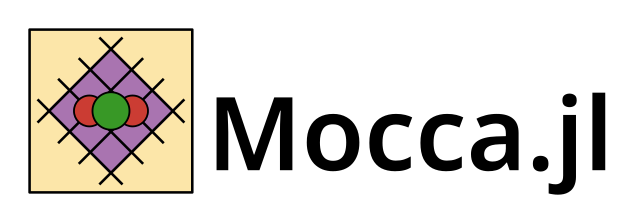

# SINTEF Applied Computational Science

Welcome to the GitHub page for the [Applied Computational Science group at SINTEF Digital](https://www.sintef.no/en/digital/departments-new/applied-mathematics/applied-computational-sciences/). For more details on us, please visit our webpage.

## Open Source Software

As a part of our contract research, we develop and maintain open source software. These are both developed by our group at SINTEF and in collaboration with industry, academia and other research institutions. Please see the respective webpages listed below for additional details.

| Software | Description |
|------|-------------|
|  |   The **MATLAB Reservoir Simulation Toolbox (MRST)** is a free open-source software for reservoir modelling and simulation. The repositories for MRST are currently hosted on GitHub: [MRST on GitHub](https://www.github.com/sintef-comg/mrst). See also the MRST website found at [mrst.no](http://www.mrst.no). |
|  | The **Open Porous Media (OPM)** initiative and the **OPM flow simulator** is hosted on the [OPM webpages](https://www.opm-project.org) and the [OPM GitHub site](https://github.com/opm). |
|  | **GPU Ocean** is a GPU-accelerated framework for running large ensembles of simplified ocean models for real-world domains. For more, see the [GPU Ocean GitHub page](https://github.com/metno/gpuocean). |
|  | **Open Quantum Computing** is an open source framework for algorithms on quantum computers.|
|  | The **Battery Modelling Toolbox (BattMo)** is a resource for continuum modelling of electrochemical devices in MATLAB. BattMo builds upon the generic features of MRST and Jutul.jl and can be found at the GitHub pages [BattMo](https://github.com/BattMoTeam/BattMo) and [BattMo.jl](https://github.com/BattMoTeam/BattMo.jl) and at [BattMo.com](https://BatteryModel.com). |
|  | **Jutul.jl** is a framework for fully differentiable multiphysics simulators based on implicit finite-volume methods with automatic differentiation be found at [the Jutul.jl GitHub page](https://github.com/sintefmath/Jutul.jl).|
|  | **JutulDarcy.jl**, the Julia-based, fully-differentiable porous media simulator can be found at [the JutulDarcy.jl GitHub page](https://github.com/sintefmath/JutulDarcy.jl). JutulDarcy uses the Jutul.jl framework to model flow and transport in subsurface reservoirs. For more information, see the [JutulDarcy.jl documentation](https://sintefmath.github.io/JutulDarcy.jl/stable/). |
|  | **Fimbul.jl** is a Julia-based toolbox for geothermal simulations based on JutulDarcy.jl. Fimbul is available at [the Fimbul.jl GitHub page](https://github.com/sintefmath/Fimbul.jl). For more information, see the [Fimbul.jl documentation](https://sintefmath.github.io/Fimbul.jl/dev/). |
|  | **Mocca.jl** is a Julia based framework for simulating CO2 capture processes. Mocca can be found on the [Mocca.jl GitHub page](https://github.com/sintefmath/Mocca.jl). More information and examples can be found in the [Mocca Docs](https://sintefmath.github.io/Mocca.jl/stable/). |
|  | SWIM (Surface Water Integrated Modeling) is an open-source software package for static modeling and prediction of surface water and urban flooding based on analysis of terrain topography. The repo is [hosted on GitHub](github.com/sintefmath/SurfaceWaterIntegratedModeling.jl), with documentation [available here](https://sintefmath.github.io/SurfaceWaterIntegratedModeling.jl/dev/). |

## Contact

For technical queries specific to one of the above projects, we recommend posting an issue to the GitHub discussion page. For MRST in particular the e-mail address [mrst@sintef.no](mailto:mrst@sintef.no) can be used if you prefer private communication. For other queries, please contact [Knut-Andreas Lie, Chief Scientist](mailto:Knut-Andreas.Lie@sintef.no).
